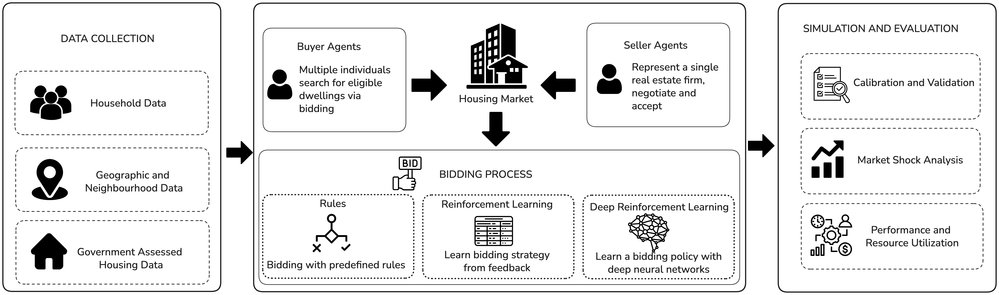
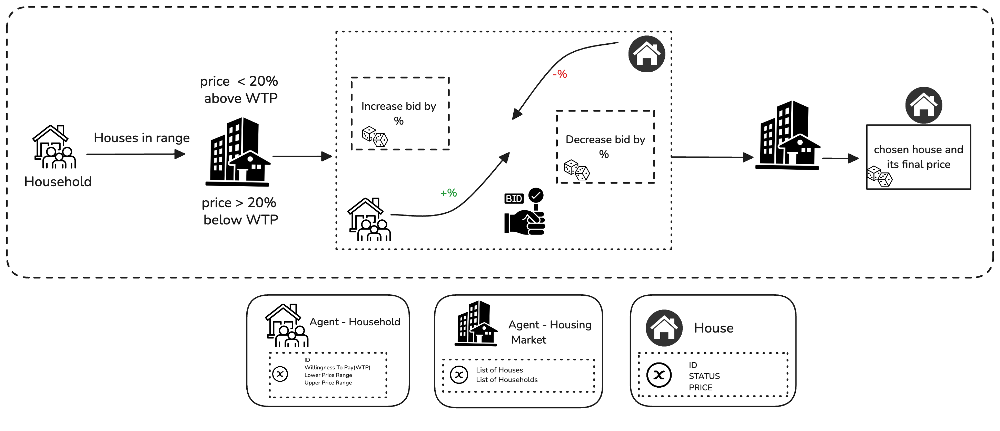
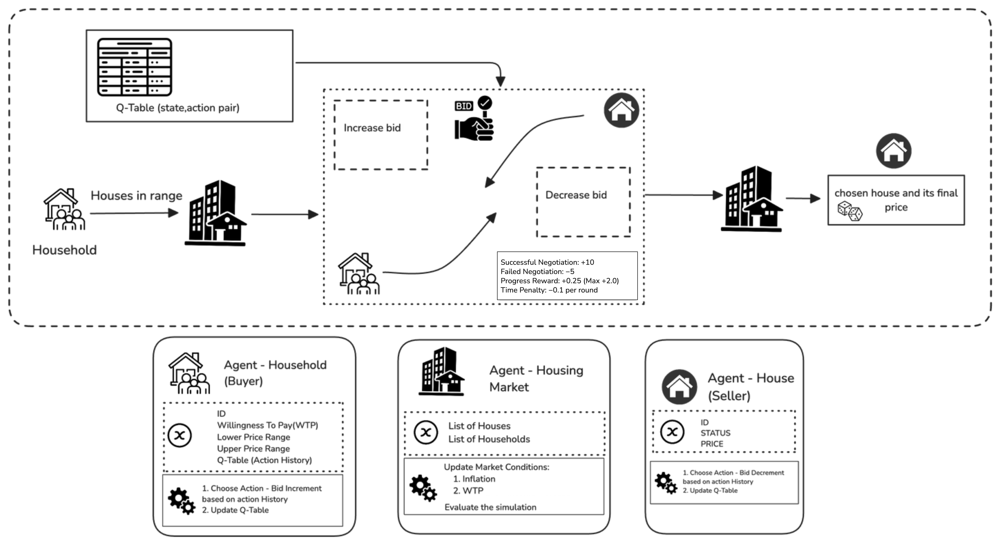
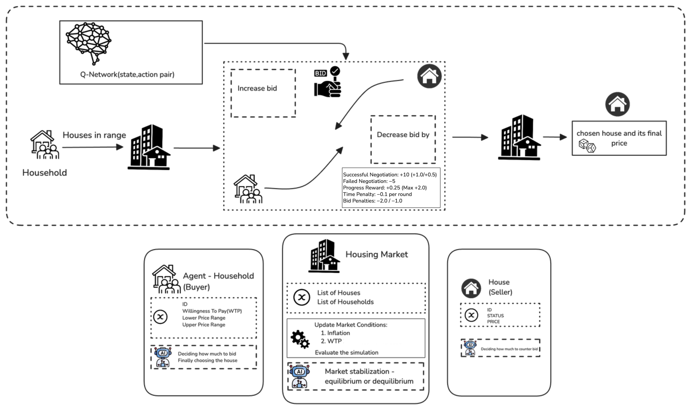

# Housing Market Simulation — Replication Package


Welcome to the replication package for Chapter 2 of the Housing Market Simulation project. This package contains the data, scripts, and outputs used to reproduce every table and figure in the chapter, which compares rule-based, Q-learning, and Deep Q-Network (DQN) bidding strategies in an agent-based model of the Halifax housing market.

## Table of Contents

1. [Introduction](#introduction)
2. [Repository Structure](#repository-structure)
3. [Requirements](#requirements)
4. [Installation](#installation)
5. [Quick Start](#quick-start)
6. [Datasets & Inputs](#datasets--inputs)
7. [Running Experiments](#running-experiments)
8. [Authors](#authors)
9. [License](#license)

## Introduction

This package provides the code and outputs for the three research questions in Chapter 2:

- **RQ1 — Performance:** training convergence of the learning-based agents, agent-level negotiation outcomes, and agreement with historical Halifax sale prices (RMSE, MAPE, Wilcoxon tests).
- **RQ2 — Market shocks:** price response to a 50% increase in new listings (supply shock) and a 50% increase in new buyers (demand shock) in 2022–2023, followed to 2028.
- **RQ3 — Computational efficiency:** training time, policy loading time, simulation time, memory use, and scaling with market size.

The three models share one market environment, the same input data, and the same market-clearing process. Only the household bidding strategy differs. The years are used as follows: 2010 initialises the market, 2011–2018 is for calibration and training, 2019–2021 for validation, and 2022–2024 for out-of-sample testing.

## Schematic

Below is an overview of the study and the three bidding workflows compared in the chapter.

### Study overview

The workflow from data collection (HMTS survey, DMTI spatial data, Halifax assessments and sales) to the three simulation models and their evaluation.



### ABM — Rule-based bidding

Households find properties within their willingness-to-pay range and open below it, while sellers open at the assessed value. Each round the household raises its bid by a fixed percentage and the seller lowers its counter-offer at a rate set by the sale-to-list ratio. Negotiation ends at agreement or when the round limit is reached.



### RL — Q-learning bidding

The fixed bid-increase rule is replaced by a tabular Q-learning policy. The state is the current bid and the seller's counter-offer, the actions are small, medium, or large bid increments, and actions are chosen epsilon-greedily. Rewards favour reaching agreement and penalise long negotiations.



### DRL — Deep Q-Network bidding

A feed-forward network estimates a Q-value for each bidding action from the normalised bid and counter-offer. It is trained from a replay buffer, with a periodically updated target network.



## Repository Structure

Key folders and files at the package root:

```
readme.md
LICENSE
requirements.txt
images/                          
inputs/                          
  HMTS Data_WTP.xlsx             
  derived/                       
src/
  replication/                   
    baseline-bidding-model/      
    baseline-olmez-rl-model/     
  data-preparation/              
  descriptive-statistics/        
  src-convergence/               
    housing_abm/                 
  src-scenario/                  
  src-model-complexity/          
results/
  descriptive-statistics/        
  results-convergence/
    calibration/                 
    tuning/                      
    training/                    
    evaluation/                  
    tables/                      
  results-scenario/
    shocks/                      
    annual_*.csv                 
  results-complexity/           
    scaling/                     
graphs/
  assessed_value_sale_price_per_year.png   
  shocks/                                 
logs/
  convergence/  scenario/  complexity/  descriptive-statistics/
```


## Requirements

- OS: macOS or Linux (development and testing done on macOS, Apple M3)
- Python: 3.11 (3.11.9 used for all runs)
- Memory: 8+ GB (16 GB used for the full experiments)
- CPU only: no GPU is used or needed, and every benchmark runs CPU-only

Install dependencies:

```bash
python -m venv venv
source venv/bin/activate
pip install -r requirements.txt
```

Pinned versions: numpy 2.0.2, pandas 2.2.3, openpyxl 3.1.5, scipy 1.15.1, matplotlib 3.10.0, seaborn 0.13.2, psutil 6.1.1, torch 2.6.0. The baseline Olmez model has its own environment file, `src/replication/baseline-olmez-rl-model/model/MESA_env.yml`.

## Installation

1. Clone the repository:

```bash
git clone https://github.com/usmimukherjee/Housing-Market-Simulation.git
cd Housing-Market-Simulation
```

2. Create and activate a virtual environment and install dependencies (see Requirements).

3. Place the inputs in `inputs/`, and the raw Halifax files in a `validation/` folder next to the package root (see Datasets & Inputs).

## Quick Start

These commands rebuild tables and figures from the saved results without retraining. Run them from the package root:

```bash
python src/descriptive-statistics/descriptive_statistics.py           # Table 2.1
python src/descriptive-statistics/price_trend_figure.py               # Figure 2 
python src/src-scenario/annual_shocks.py                              # Figures 7–8
python src/src-model-complexity/compute_benchmark.py --summarise-only # Table 2.5
python src/src-model-complexity/scaling_benchmark.py --summarise-only # Table 2.6
(cd src/src-convergence && python 5_make_figures_tables.py)           # Tables 2.2–2.4
```

## Datasets & Inputs

- HMTS survey extract: `inputs/HMTS Data_WTP.xlsx` (household characteristics and WTP worksheet)
- Derived model inputs: `inputs/derived/` (`observed_annual.csv`, `observed_ratio.csv`, `listing_pool.csv`, `buyers.csv`, `record_counts.csv`)
- Raw Halifax sales and assessments
  - `HRM_sale_data_yearly.csv`
  - `Assessed_Value_and_Taxable_Assessed_Value_History.csv`

  Please contact the authors for the data. It is proprietary and cannot be released publicly.

## Running Experiments

Experiments are organised by research question:

- **Data (Section 2.2):** `src/descriptive-statistics/` → `results/descriptive-statistics/`, `graphs/` (Table 2.1, Figure 2)
- **Convergence and historical agreement (RQ1):** `src/src-convergence/` → `results/results-convergence/` (Tables 2.2–2.4)
- **Scenario analyses, supply and demand shocks (RQ2):** `src/src-scenario/` → `results/results-scenario/`, `graphs/shocks/` (Figures 7–8)
- **Model complexity (RQ3):** `src/src-model-complexity/` → `results/results-complexity/` (Tables 2.5–2.6)

A full run takes about 6 h on 8 CPU cores, plus about 1.5 h of benchmarks.

1. Prepare inputs: `python src/data-preparation/prepare_observed_data.py` writes `inputs/derived/`.
2. Descriptive statistics: `descriptive_statistics.py` and `price_trend_figure.py` in `src/descriptive-statistics/`.
3. RQ1: from `src/src-convergence/`, run in order:
   - `1_calibrate_market.py`
   - `2_tune_hyperparameters.py --model both`
   - `2b_dqn_stability_fixes.py`
   - `3_train_final.py` 
   - `4_evaluate.py`
   - `5_make_figures_tables.py`

   Steps 2–4 accept `--workers N` (default 8).
4. RQ2: `src/src-scenario/market_shocks.py`, then `annual_shocks.py`.
5. RQ3: `src/src-model-complexity/compute_benchmark.py` and `scaling_benchmark.py`. Use `--summarise-only` to rebuild the summaries from saved runs.
6. Console logs from the runs used in the chapter are in `logs/<experiment>/`.

## Authors

- **Usmi Mukherjee** — Dalhousie University, usmi.mukherjee@dal.ca
- **Mohammad Masudur Rahman** - Dalhousie University
- **Muhammad Ahsanul Habib** - Dalhousie University


## License

This project is licensed under the MIT License. See the `LICENSE` file for details. 

---

If you need assistance reproducing specific experiments, please open an issue or contact the authors.
